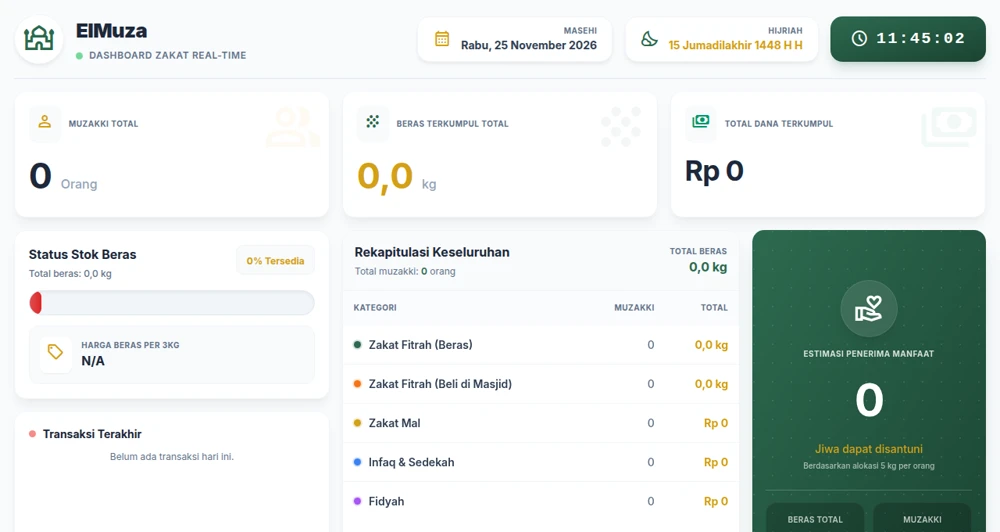
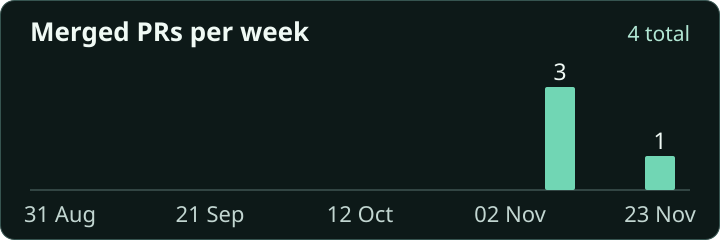

<h1 align="center">
  
</h1>

  <a href="https://www.juanalma.cloud/">Portfolio</a> ·
  <a href="https://www.linkedin.com/in/juanangelaalma">LinkedIn</a> ·
  <a href="mailto:juanangelaalma@gmail.com">Email</a>

I'm based in Indonesia and build web apps and APIs for workflows like collecting zakat, processing donations, and tracking nutrition.

## Featured Projects

### [El Muna Zakat](https://github.com/juanangelaalma/elmuna-zakat-v2)

A zakat management system that tracks cash and rice contributions from collection to shift handover.

- Amil teams record contributions and send digital receipts via WhatsApp.
- At shift handover, staff reconcile cash and rice balances.
- A public dashboard shows collection totals.

`Laravel` · `React` · `Inertia.js` · `TypeScript`

*Dashboard preview from a local instance with no transaction data.*

### [AksiHijau](https://github.com/Aksi-Hijau/aksihijau-backend)

I worked on the backend for this Bangkit capstone, which combines tree-planting campaigns and donations with soil analysis and plant recommendations. The API handles campaigns, donations, and Midtrans payments.

`Node.js` · `Express` · `MySQL` · `Midtrans`

### [Mediku](https://github.com/MantaSetel/mediku-backend)

Backend for a child growth and nutrition app. The API connects nutrition models with food data, nutrition reference values, and daily assessment records.

`Node.js` · `MySQL` · `TensorFlow.js` · `Google Cloud`

[More projects on my portfolio](https://www.juanalma.cloud/#projects)

## Recent Open Source Contributions

Public pull requests merged in other accounts' repositories over the last 13 weeks, including the current week. Weeks start on Monday (UTC); the chart refreshes daily.

[All merged public pull requests](https://github.com/pulls?q=is%3Apr+is%3Amerged+is%3Apublic+author%3Ajuanangelaalma+-user%3Ajuanangelaalma)

## Technical Stack

- **Frontend:** TypeScript, JavaScript, React, Next.js, Tailwind CSS
- **Backend:** Node.js, Express, Laravel
- **Data and deployment:** PostgreSQL, MySQL, MongoDB, Docker, Google Cloud

## GitHub Activity

